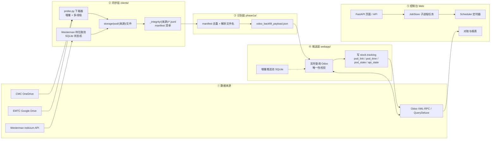
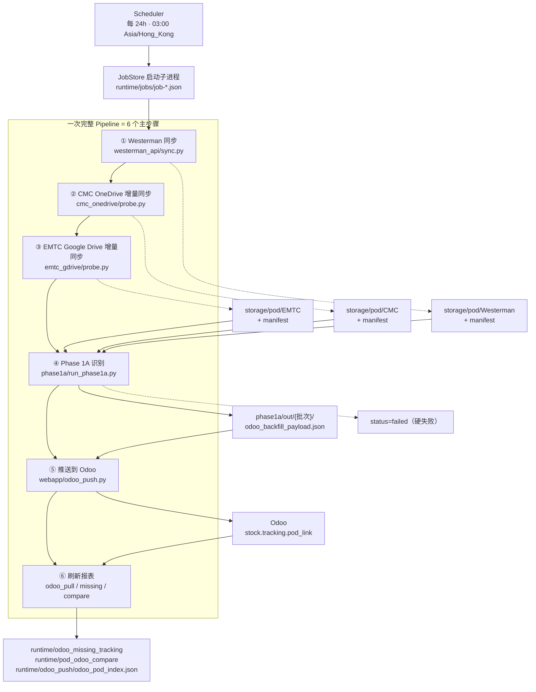
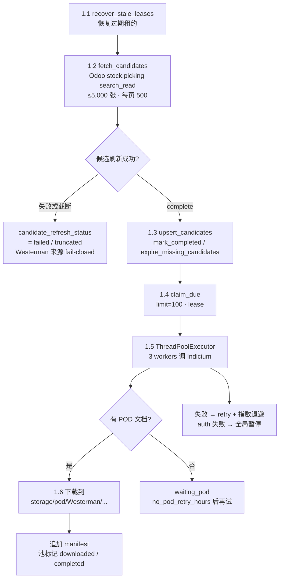
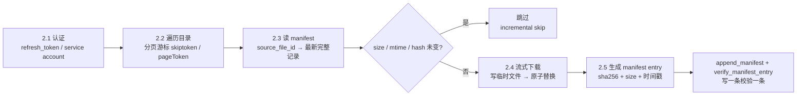
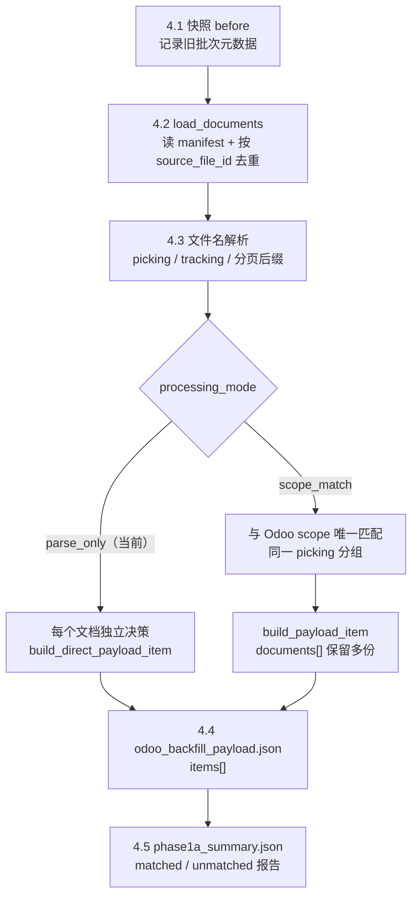
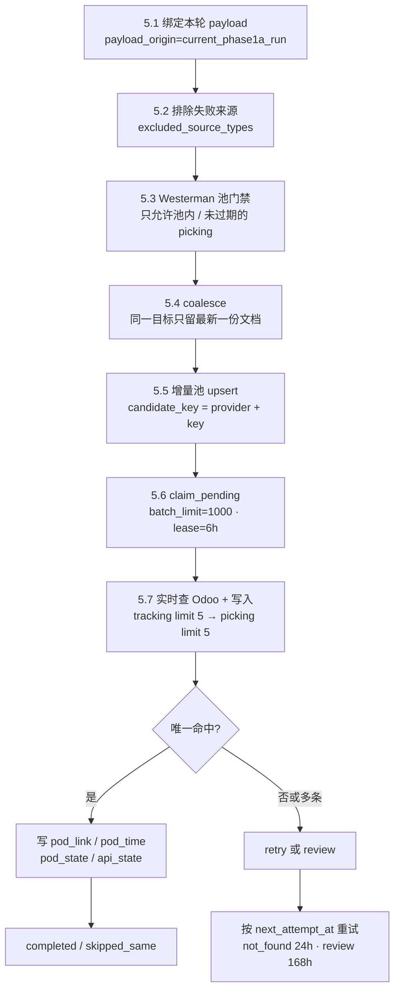
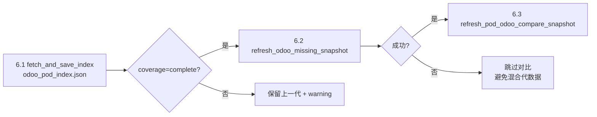
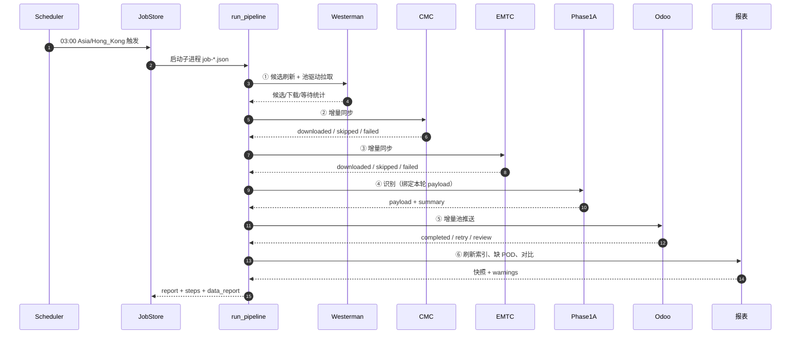
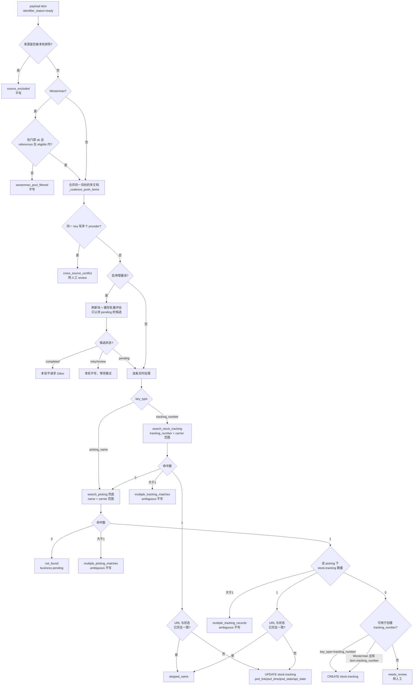

# pod_sync 项目与代码分析

> 生成时间：2026-10-29
> 分析基线：`main` 分支 `0f79cd4`（"添加日期过滤功能"）
> 说明：本文合并了项目结构分析，并重点补充「推送 Odoo 时如何填写 `stock.tracking`」的完整逻辑。
> 文中行号基于上述 commit，后续代码变动时请以最新源码为准。

---

## 目录

- [1. 项目定位](#1-项目定位)
- [2. 技术栈与代码规模](#2-技术栈与代码规模)
- [3. 整体架构与数据流](#3-整体架构与数据流)
- [4. 目录与代码构成](#4-目录与代码构成)
- [5. 端到端流水线（同步机制全景）](#5-端到端流水线同步机制全景)
- [6. 各模块详解](#6-各模块详解)
- [7. 运行时状态与数据存储](#7-运行时状态与数据存储)
- [8. 推送到 Odoo：stock.tracking 填写逻辑（重点）](#8-推送到-odoostocktracking-填写逻辑重点)
- [9. 关键设计原则与防错机制](#9-关键设计原则与防错机制)
- [10. 配置与运行](#10-配置与运行)
- [11. 风险与改进建议](#11-风险与改进建议)
- [12. 关键代码位置索引](#12-关键代码位置索引)

---

## 1. 项目定位

`pod_sync` 是一个 **POD（Proof of Delivery，签收凭证）自动化同步系统**，处理三家承运商/仓库的签收单：

| 来源 | 获取方式 | 主要识别依据 |
| --- | --- | --- |
| CMC | Microsoft OneDrive（Graph API） | 文件名中的出库单号（picking name） |
| EMTC | Google Drive（Drive API） | 文件名中的运单号（tracking number） |
| Westerman | Westerman Indicium API | Odoo 候选出库单 + shipment reference |

业务闭环：

```
拉取签收单 → 保存并校验文件完整性 → 识别出库单/运单号
→ 在 Odoo 确认唯一目标 → 写入 Odoo stock.tracking
→ 刷新对账与覆盖率报表
```

系统的第一原则写在交接文档中：

> **宁可暂时不写，也不能把 POD 写错出库单。**

代码中的大部分复杂度（唯一性校验、来源隔离、幂等、门禁、推送池）都服务于这条原则。

### 重要事实

- 系统写入的是 `stock.tracking` 的 POD 字段，**不是** `stock.picking.x_studio_pod_link`。
- Odoo 侧的 `tw_stock_tracking` 模块再按条件把 tracking 汇总回 `stock.picking`。
- 写入的 POD 链接必须是本系统自己的 `{base_url}/storage/files/...` 地址，**不允许写回 OneDrive/Google Drive 源链接**。

---

## 2. 技术栈与代码规模

| 维度 | 情况 |
| --- | --- |
| 语言 | Python 3.10 |
| Web 框架 | FastAPI + Jinja2 + uvicorn |
| 外部协议 | Microsoft Graph、Google Drive REST、Westerman REST、Odoo XML-RPC、QueryDeluxe HTTP |
| 存储 | 本地文件系统 + SQLite（手写 SQL，无 ORM），文件锁使用 `fcntl.flock` |
| 测试 | `unittest`，31 个测试文件 |
| 依赖 | `requirements.txt` / `requirements.lock`（固定版本） |
| 代码量（排除 venv/runtime） | 约 **44,600 行** |
| 现有数据 | `storage/pod` 约 8.2 GB（EMTC 6.3G / CMC 1.7G / Westerman 59M / manifest 137M），Phase 1A 已产生 208 个批次 |
| 部署 | 单机 + 反向代理，生产 `https://pod.eleways.online` |

各目录代码行数：

| 目录 | 行数 | 说明 |
| --- | --- | --- |
| `webapp/` | 15,727 | 控制台、编排、推送、对账、报表 |
| `tests/` | 16,857 | 测试（接近生产代码量） |
| `clients/` | 5,407 | 三家来源的下载客户端 |
| `phase1a/` | 4,558 | 解析、匹配、payload、dashboard |
| `ops/` | 2,086 | 运维命令 |
| 合计 | 约 44,600 | |

---

## 3. 整体架构与数据流



数据流的关键约定：

1. **文件是唯一入口**：所有来源最终都落成 `storage/pod/{warehouse}/...` 下的文件，并追加一行 manifest。
2. **manifest 是识别与幂等的事实基础**：Phase 1A 只读 manifest，不直接读云盘。
3. **payload 是推送的唯一输入**：Odoo 写入只接受 Phase 1A 本轮产出的 payload（或显式指定且校验通过的 payload）。
4. **Odoo 是唯一事实源**：推送前必须实时查询，不能只信本地索引或缓存。

---

## 4. 目录与代码构成

```
pod_sync/
├── start                       # 一键启动（venv、依赖、密钥、uvicorn）
├── config.example.json         # 脱敏配置模板
├── config.local.json           # 真实配置（600 权限，不入 git）
├── clients/
│   ├── common/
│   │   ├── sync_integrity.py   # manifest、sha256、下载、文件锁
│   │   └── extract_tracking_candidates.py
│   ├── cmc_onedrive/
│   │   ├── probe.py            # Graph API 同步入口
│   │   └── get_refresh_token.py
│   ├── emtc_gdrive/
│   │   └── probe.py            # Drive API 同步入口
│   └── westerman_api/
│       ├── probe.py            # Indicium API 单票查询/下载
│       ├── sync.py             # 批量同步（池驱动）
│       ├── pool.py             # SQLite 待拉取池状态机
│       └── candidates.py       # 从 Odoo 只读发现候选
├── phase1a/
│   ├── run_phase1a.py
│   ├── phase1a_pod/
│   │   ├── parsing.py          # 文件名 → picking/tracking 候选
│   │   ├── matching.py         # 与 Odoo scope 唯一匹配
│   │   ├── pipeline.py         # 主编排、payload 组装
│   │   ├── westerman_gate.py   # Westerman fail-closed 门禁
│   │   ├── dashboard.py        # 巡检 HTML
│   │   ├── io_utils.py
│   │   └── cli.py
│   ├── examples/
│   └── out/{YYYYMMDD####}/     # 每轮产物
├── webapp/
│   ├── app.py                  # 路由、认证、CSRF
│   ├── pipeline_runner.py      # 6 步流水线编排
│   ├── jobs.py                 # 子进程任务存储与执行
│   ├── scheduler.py            # 定时调度
│   ├── actions.py              # 白名单命令构建
│   ├── odoo_push.py            # 核心写入逻辑
│   ├── odoo_push_pool.py       # 增量推送池
│   ├── odoo_reconcile_cache.py # Odoo XML-RPC 增量缓存
│   ├── odoo_read_backends.py   # querydeluxe / shadow / xmlrpc
│   ├── odoo_pull.py            # 已存在 POD 索引
│   ├── reporting.py
│   ├── emtc_reconcile.py
│   ├── odoo_missing_report.py
│   ├── odoo_pod_compare.py
│   ├── annual_pod_report.py
│   ├── file_browser.py
│   ├── file_odoo_push.py       # 单文件推送
│   ├── phase1a_runs.py
│   ├── signed_urls.py
│   ├── xlsx_utils.py
│   ├── remote_counts.py
│   └── pod_sources.py
├── ops/                        # 运维命令行
├── tests/ + phase1a/tests/
├── storage/pod/                # 下载文件 + manifest
└── runtime/                    # 任务、调度、SQLite 池、快照
```

---

## 5. 端到端流水线（同步机制全景）

编排入口是 `webapp/pipeline_runner.py` 的 `run_pipeline()`（`webapp/pipeline_runner.py:262`）。**主干固定为 6 个主步骤**，每一步都是独立子进程，失败按「硬失败 / 软失败」分级；报表刷新在任务 `steps` 数组里拆成 3 条记录，所以一份 job 报告会看到 8 条 step。

> 一句话：**Westerman → CMC → EMTC → Phase 1A 识别 → 推送 Odoo → 刷新报表**。

### 5.1 全景图



### 5.2 一共几步：6 个主步骤

| # | 步骤键 | 名称 | 入口 | 输入 | 输出 / 落盘 | 失败级别 | 跳过开关 |
| --- | --- | --- | --- | --- | --- | --- | --- |
| 1 | `westerman_sync` | Westerman 同步（池驱动） | `clients/westerman_api/sync.py` | Odoo 候选 + Westerman 拉取池 | POD 文件 + manifest + 池状态 | 软失败 | `--skip-westerman` |
| 2 | `cmc_sync` | CMC OneDrive 增量同步 | `clients/cmc_onedrive/probe.py` | OneDrive 目录 + manifest | POD 文件 + manifest | 软失败 | `--skip-cmc` |
| 3 | `emtc_sync` | EMTC Google Drive 增量同步 | `clients/emtc_gdrive/probe.py` | Google Drive 目录 + manifest | POD 文件 + manifest | 软失败 | `--skip-emtc` |
| 4 | `phase1a` | Phase 1A 识别 | `phase1a/run_phase1a.py` | 三个来源的 manifest | `odoo_backfill_payload.json` + 识别报告 | **硬失败** | `--skip-phase1a`（跳过时必须显式给 payload） |
| 5 | `odoo_push` | 推送到 Odoo | `webapp/odoo_push.py` | 本轮 payload | `stock.tracking` 字段 + 推送池状态 | 技术失败软、payload 绑定硬 | `--skip-odoo-push` |
| 6 | `refresh_reports` | 刷新 3 份报表 | `webapp/pipeline_runner.py:836-934` | Odoo 实时数据 + 本轮 POD | `odoo_pod_index.json`、`odoo_missing_tracking/*`、`pod_odoo_compare/*` | 软失败 / 警告 | `--skip-reports` |

按实现展开，6 个主步骤可以拆成 **32 个可观测子阶段**：Westerman 6 个 + CMC 5 个 + EMTC 5 个 + Phase 1A 5 个 + 推送 8 个 + 报表 3 个。其中任何一步被跳过（`--skip-`*），后续依赖它的步骤仍按各自规则执行或显式失败。

**最近一次实际运行**（`job-20261028-190004-96fb1d1d`，2026-10-28 19:00 UTC，总耗时 683.1 秒）：

| # | 步骤 | 本轮实际数据 |
| --- | --- | --- |
| 1 | Westerman | 活跃候选 26、到期 1、实际检查 1、等待 POD 1、下载 0；Phase 1A 门禁另过滤掉 535 条不在池 allow-list 的 manifest 记录 |
| 2 | CMC | 下载 89 个文件 / 跳过 25,079 / 失败 0 / 5.4 MB |
| 3 | EMTC | 下载 89 个文件 / 跳过 38,995 / 失败 0 / 15.6 MB |
| 4 | Phase 1A | 64,347 个文档 → 64,082 条 ready payload、348 条 review（CMC 拆单会让 ready 行数略高于文档数） |
| 5 | 推送 Odoo | 64,082 输入 → 合并为 62,429 个目标（1,653 份 superseded）→ 认领 69 → 实际写入 69 |
| 6 | 报表 | 索引、缺 POD 报告、POD vs Odoo 对比 3 项全部刷新成功 |

### 5.3 步骤 1：Westerman 同步（池驱动，6 个子阶段）

与 CMC/EMTC 的「扫目录」不同，Westerman 是**先从 Odoo 反查该拉哪些单，再用 SQLite 池逐个拉取**。



| 子阶段 | 做什么 | 关键代码 |
| --- | --- | --- |
| 1.1 恢复租约 | 把超过 `lease_until` 仍为 `leased` 的候选改回 `pending`，避免进程崩溃后永久卡住 | `sync.py:444` |
| 1.2 刷新候选 | 按 `outgoing + carrier.delivery_type=westman + state + wms_status + 180 天` 查 Odoo，并排除已有 `pod_link` 的 picking | `candidates.py:58-82`、`104-148` |
| 1.3 同步池 | 新候选 `upsert`；Odoo 已有 POD 的标记 `completed`；本轮不在候选集里的 `expire` | `sync.py:475-505` |
| 1.4 认领 | `claim_due(limit=pool_batch_limit=100, lease_seconds)`，默认 3 个 worker | `sync.py:541-548` |
| 1.5 拉取 | 调 Indicium 的 `get_order_info` / `download_document`，每个 shipment 一个租约 | `sync.py:563-580` |
| 1.6 落盘/推进 | 文件写入 `storage/pod/Westerman/...`，追加 manifest，池状态改为 `downloaded`/`completed`；无 POD 则 `waiting_pod` | `sync.py:281-390` |

**为什么最先跑**：Westerman 是按计划轮询的独立来源。如果放在 CMC/EMTC 之后，一旦云盘来源硬失败，本轮就没机会执行 Westerman 的候选刷新和拉取（`pipeline_runner.py:347-352` 有注释）。**候选刷新不完整（failed/truncated）时整个 Westerman 来源不参与推送**，这是 fail-closed。

### 5.4 步骤 2/3：CMC、EMTC 增量同步（5 个子阶段）

两个来源结构同构，都是「遍历云盘 → 与 manifest 比对 → 只下载变化文件」。



| 子阶段 | 做什么 | 关键代码 |
| --- | --- | --- |
| 2.1 认证 | CMC 用 Graph `refresh_token` 自动续期并回写；EMTC 用 service account | `cmc_onedrive/probe.py`、`emtc_gdrive/probe.py` |
| 2.2 遍历 | 递归列目录，处理分页游标；CMC 对 `skiptoken` 400 错误最多重试 5 次并统计恢复次数 | `cmc_onedrive/probe.py:566-1009` |
| 2.3 比对 | `load_manifest_skip_index()` 建立 `source_file_id → 最新记录`，`manifest_entry_is_current()` 判断是否可跳过 | `sync_integrity.py:240-252`、`cmc_onedrive/probe.py:1164` |
| 2.4 下载 | 流式写盘 + sha256，多 worker 共享 manifest 文件锁 | `cmc_onedrive/probe.py:1033-1094`、`emtc_gdrive/probe.py:265` |
| 2.5 校验 | 追加 manifest 后立即 `verify_manifest_entry()`，检查文件存在、大小、远端大小、sha256 | `sync_integrity.py:256-280` |

命令行参数：

```bash
python3 clients/cmc_onedrive/probe.py --config ... --download-all-files --recursive --incremental --limit N --workers N
python3 clients/emtc_gdrive/probe.py    --config ... --download-all-files --recursive --incremental --limit N --workers N
```

**失败影响**：单个来源失败只记 `soft_failed_steps`，其他来源继续；失败的来源会被加入 `excluded_push_source_types`（`onedrive` / `gdrive`），本轮不推送它的 POD，避免把不完整快照写进 Odoo。

### 5.5 步骤 4：Phase 1A 识别（5 个子阶段）



| 子阶段 | 做什么 | 关键代码 |
| --- | --- | --- |
| 4.1 快照 | 记录执行前的批次状态，确保本轮 payload 只属于本轮子进程，防止并发流水线串数据 | `pipeline_runner.py:486-498` |
| 4.2 加载/去重 | 只读 manifest，按 `source_file_id` 去重保留最新完整记录，不直接读云盘 | `pipeline.py:287-330` |
| 4.3 解析 | 文件名 → picking / tracking 候选；页码后缀、CMC 简写、连续单号拆分 | `parsing.py` |
| 4.4 组装 payload | `parse_only`：每个文档通常一条 item（CMC 连续单号会一文件拆成多条）；`scope_match`：同一 picking 合成一条、`documents[]` 保留多份 | `pipeline.py:634-702`、`563-631` |
| 4.5 写报告 | `phase1a_summary.json`、matched/unmatched JSON+CSV、`odoo_backfill_payload.json` | `pipeline.py:919-931` |

**关键约束**：本轮推送**必须**使用本轮 Phase 1A 产出的 payload。`--skip-phase1a` 时必须显式传 `--odoo-push-payload`，且 payload 要通过校验；不允许事后去全局最新批次里取（`pipeline_runner.py:303-330`、`526-530`）。

**失败影响**：Phase 1A 是**硬失败**——直接返回 `status=failed`，不会进入推送，因为识别结果不可信时继续写 Odoo 风险更高。

### 5.6 步骤 5：推送到 Odoo（8 个子阶段）

详细决策树见 [8.4 完整决策流程](#84-完整决策流程)。这里给出编排层的 8 个子阶段：



| 子阶段 | 做什么 | 关键代码 |
| --- | --- | --- |
| 5.1 绑定 payload | 只用本轮 Phase 1A 产物，记录 `payload_path` 与 `payload_origin` | `pipeline_runner.py:590-650` |
| 5.2 来源排除 | 本轮失败的来源不推送，避免不完整快照写入 | `pipeline_runner.py:394-481` |
| 5.3 Westerman 门禁 | 只允许 Westerman 拉取池内、且候选刷新未过期的 picking；池状态不完整时整个来源 fail-closed | `phase1a/phase1a_pod/westerman_gate.py`、`odoo_push.py:466-500` |
| 5.4 coalesce | `stock.tracking.pod_link` 是单值，同一目标只保留 `(source_modified_at, file_name, document_uid)` 最大的一份，其余 `superseded` | `odoo_push.py:794-900` |
| 5.5 池 upsert | 按 `(provider_identity, key_type, key_value)` 建候选；fingerprint 变化才重置状态 | `odoo_push_pool.py:282-393` |
| 5.6 认领 | `claim_pending(limit=batch_limit=1000)`，租约 6 小时，过期自动回收 | `odoo_push_pool.py:516-560` |
| 5.7 查询/写入 | 先按 `tracking_number` 查 `stock.tracking`（limit 5）；没命中再按 `name` / `carrier_tracking_ref` 查 `stock.picking`（limit 5）；唯一命中才写 | `odoo_push.py:272-315`、`1574-1619` |
| 5.8 状态落库 | `pushed_tracking` / `created_tracking` / `skipped_same` → `completed`；其他 → `retry` / `review` | `odoo_push_pool.py:562-633` |

**失败影响**：技术失败记为软失败，继续刷新报表；**payload 绑定失败**（如 `--skip-phase1a` 但没给 payload）是硬失败。业务上的 `not_found` / 多条命中不算技术失败，job 状态是 `ok + business_status=attention`。

### 5.7 步骤 6：刷新报表（3 个子步骤）



按顺序：

1. `odoo_pull.fetch_and_save_index()` → `runtime/odoo_push/odoo_pod_index.json`；即使本轮没推送也要刷新。
2. `refresh_odoo_missing_snapshot()` → `runtime/odoo_missing_tracking/*`（Odoo 缺 tracking number 报告）。
3. `refresh_pod_odoo_compare_snapshot()` → `runtime/pod_odoo_compare/*`（POD ↔ Odoo 对比）。

**代约束**：只有 1 和 2 都成功才执行 3，否则跳过对比，避免新旧两代数据混在一张报表里。报表失败只记 warning，保留上一代产物，不回滚已写入 Odoo 的数据。

### 5.8 一次 03:00 调度的时序



### 5.9 失败分级与继续策略

| 步骤 | 失败级别 | 后果 |
| --- | --- | --- |
| Westerman | 软失败 | 继续 CMC/EMTC；候选刷新不完整时**整个 Westerman 来源不推送** |
| CMC | 软失败 | 继续；本轮排除 `onedrive` 来源 |
| EMTC | 软失败 | 继续；本轮排除 `gdrive` 来源 |
| Phase 1A | **硬失败** | 立即 `status=failed`，不推送 |
| Payload 绑定 | **硬失败** | 立即 `status=failed`（防止串批次） |
| Odoo 推送（技术） | 软失败 | 继续刷新报表，结果保留 |
| Odoo 推送（业务） | 非失败 | `ok + business_status=attention` |
| 报表刷新 | 警告 | 保留上一代；上游失败时跳过下游对比 |

**为什么这么分级**：来源缺失只会让本轮 POD 变少，可以安全地“少推”；识别或 payload 绑定出错会让“推什么”不可信，必须停；报表只是展示层，失败不应影响已经写入 Odoo 的数据。

### 5.10 流水线状态语义

| 状态 | 含义 |
| --- | --- |
| `ok` + `business_status=complete` | 程序与业务均完成 |
| `ok` + `business_status=attention` | 程序成功，但有未找到/多条命中/需人工确认 |
| `partial` | 有真实技术步骤失败，其他结果保留 |
| `failed` | 关键步骤无法安全执行 |

---

## 6. 各模块详解

### 6.1 同步层 `clients/`

#### CMC OneDrive（`clients/cmc_onedrive/probe.py`，1362 行）

- **认证**：`access_token` 或 `refresh_token` 自动续期；续期成功后回写配置文件，避免重启后失效。
- **遍历**：`iter_collection()` 处理 Graph 分页；对带 `skiptoken` 的 400 错误最多重试 5 次，并记录游标恢复统计（`cursor_restart_count` / `cursor_recovered_count` / `cursor_failure_count`）。
- **下载**：`download_and_record_file()`（`probe.py:1033`）流式写盘 + sha256 + manifest 追加 + 立即校验。
- **增量**：`load_manifest_skip_index()` 建立 `source_file_id → 最新记录` 索引；只有 `modified_time` 一致且 `local_size` / `sha256` 校验通过才跳过。

```python
# clients/cmc_onedrive/probe.py:1165-1176
if incremental and not item.get("_cursor_replayed_changed") and file_id in skip_index:
    if manifest_entry_is_current(
        skip_index[file_id],
        source_modified_time=item.get("modified_time"),
        verify_hash=verify_incremental_hash,
    ):
        summary["skipped_files"] += 1
        continue
```

- **并发**：多 worker 共用一个 manifest，`threading.Lock` + `flock` 保证 JSONL 行完整。

#### EMTC Google Drive（`clients/emtc_gdrive/probe.py`，555 行）

结构与 CMC 类似，差异：

- Drive `files.list` 使用 `pageToken` 分页；
- Google 原生文档需要 `export`，导出时无法预知大小，因此 `verify_remote_size=False`；
- 下载路径直接使用云端相对路径。

#### Westerman（`clients/westerman_api/`，4 个文件）

不是「扫目录」，而是 **Odoo 候选驱动 + SQLite 池状态机**：

1. **候选发现**（`candidates.py`）：只读查询 Odoo `stock.picking`：
   - `carrier_id.delivery_type = westman`
   - `state in (waiting, assigned, done)`
   - WMS 状态在 `sent / partial_ref_back / ref_back / pod`
   - 最近 180 天
   - 排除已有 `stock.tracking.pod_link` 的出库单
2. **入池**（`pool.upsert_candidates()`）：按 `shipment_reference` upsert。
3. **认领**（`pool.claim_due()`）：用租约（`lease_owner` / `lease_until`）原子认领到期项。
4. **单票查询**（`probe._run_indicium()`，`probe.py:413`）：
   - `POST /get_order_info`，body `{"shipment_reference": ...}`；
   - 校验返回的 `shipment_reference` 与请求一致；
   - 只处理 `document_type` 在 `pod_document_types`（默认 `["POD"]`）里的附件；
   - `GET /download_document?document_id=...`；
   - Base64 解码后写盘，文件名用 document ID 与内容 SHA256 前缀。
5. **状态迁移**：

| pull_state | 含义 |
| --- | --- |
| `pending` | 到期待查 |
| `checking` | 被某 worker 租约持有 |
| `waiting_pod` | API 正常但暂无 POD，默认 24h 后再查 |
| `downloaded` | 已下载，可进入识别/推送 |
| `retry` | 网络/限流/临时错误，指数退避 |
| `failed` | 确定性失败，默认 24h 后重试 |
| `expired` | 已离开业务候选范围 |
| `completed` | Odoo 已有 POD，不再查询 |

`push_state` 独立记录推送侧状态：`not_ready / pending / pushed / needs_review / failed / completed`。

6. **熔断**：401/403 触发 `auth_event`，本批后续请求全部转 `retry`（默认 6h 后），避免触发供应商限流/封禁。
7. **候选刷新状态**：`running / complete / failed / truncated / skipped` 持久化在 `pod_pool_meta`。未 `complete` 时，本轮所有 Westerman 写入关闭（fail-closed）。

### 6.2 完整性基础设施 `clients/common/sync_integrity.py`

- `save_stream_to_file()`：流式落盘、计算 sha256、超过上限即删除半成品（默认 200MB，可用 `POD_SYNC_MAX_DOWNLOAD_BYTES` 调整）。
- `append_manifest_entry()`：JSONL 追加 + `flock` 排它锁，多进程/多线程安全。

```python
# clients/common/sync_integrity.py:205-217
def append_manifest_entry(manifest_path, entry):
    manifest_path = Path(manifest_path)
    manifest_path.parent.mkdir(parents=True, exist_ok=True)
    with manifest_path.open("a", encoding="utf-8") as fh:
        fcntl.flock(fh.fileno(), fcntl.LOCK_EX)
        try:
            fh.write(json.dumps(entry, ensure_ascii=False) + "\n")
            fh.flush()
        finally:
            fcntl.flock(fh.fileno(), fcntl.LOCK_UN)
```

- `load_manifest_skip_index()`：每个 `source_file_id` 取最后一条记录。
- `verify_manifest_entry()`：检查文件存在、本地大小、远端大小、sha256，任何一项不符即 `failed`，禁止进入推送。
- `manifest_entry_is_current()`：增量跳过判定；旧 manifest 如果没有记录 `local_size`/`sha256`，会强制重新下载一次以建立可信基线。

### 6.3 识别层 `phase1a/`

#### 文件名解析规则（`phase1a/phase1a_pod/parsing.py`）

| 来源 | 输入样例 | 解析结果 |
| --- | --- | --- |
| CMC | `EU22114.pdf` | `WCB2B/OUT/22114` |
| CMC | `HK23898.pdf` | `WCB2C/OUT/23898` |
| CMC | `WBB2BRET01301` | `WBB2B/RET/01301` |
| CMC | `Other07400` | `Other/07400` |
| CMC | `23735-1.pdf` / `23735_1.pdf` | `WCB2B/OUT/23735`（`-1` 视为页码） |
| CMC | `WCB2BOUT19782A` | `WCB2B/OUT/19782`（去掉尾部噪声字母） |
| EMTC | `2026-03-19_3SYZXG8293874.png` | tracking `3SYZXG8293874` |
| EMTC | `LA857793468NL` | 保留完整 postal tracking |
| Westerman | `WDB2B/OUT/01358` | 直接作为 picking_name |

解析入口 `infer_document_fields()`（`parsing.py:290`）会输出：

- `inferred_picking_names[]`
- `inferred_tracking_numbers[]`
- `parse_notes[]`（如 `picking_name_not_found`、`multiple_picking_candidates`、`source_url_missing`）

特别规则：Westerman 的 tracking 只取 `Shipment.external_id`，不再从文件名里猜数字，避免内部编号把唯一记录搞成多候选（`parsing.py:315-319`）。

#### 两种处理模式

| 模式 | 触发条件 | 行为 |
| --- | --- | --- |
| `parse_only` | 默认 | 只解析文件名，能唯一确定就生成 payload，不查 Odoo |
| `scope_match` | 配置了 `odoo_scope_path` | 与 Odoo scope 交叉匹配，唯一命中才可推送 |

#### 匹配规则（`phase1a/phase1a_pod/matching.py`）

- 先按 `picking_name` 匹配，未命中再按 `tracking_number` 匹配；
- 命中 1 条 → `matched`；
- 命中多条 → `unmatched` + `MULTIPLE_PICKING_CANDIDATES`，**绝不取第一条**；
- 命中但被 scope 过滤 → `ODOO_SCOPE_FILTERED_OUT`；
- 完全没命中 → `NO_PICKING_FOUND` / `INVALID_PICKING_KEY`。

#### Phase 1A 产物

| 文件 | 内容 |
| --- | --- |
| `parsed_documents.json` | 所有文档的解析结果与候选 |
| `pod_backfill_matched_report.csv/json` | 可推送清单 |
| `pod_backfill_unmatched_report.csv/json` | 待处理清单（附 `reason_code`） |
| `odoo_backfill_payload.json` | 推送 payload |
| `phase1a_summary.json` | 汇总数字、来源状态、门禁证据 |
| `phase1a_dashboard_data.json` / `.html` | 巡检面板 |

payload 结构：**一个目标 picking 一条 item，文档挂在** `documents[]` **下**。同一出库单的多页/多附件会合并，主文档取 `source_modified_at` 最新的一条（`pipeline.py:563` `build_payload_item`）。

#### Westerman 门禁（`phase1a/phase1a_pod/westerman_gate.py`）

`evaluate_westerman_pool_gate()`（`westerman_gate.py:67`）只有在以下条件全部满足时返回 `ok`：

1. 池文件存在且可读；
2. `pod_pool_meta.candidate_refresh_status == "complete"`；
3. 刷新时间不超过 `candidate_refresh_max_age_hours`（默认 48h，最大 30 天）；
4. 单据 `pull_state == "downloaded"` 且 `push_state == "pending"`。

返回的 `eligible_references` 就是本轮允许进入 Phase 1A / 推送的 Westerman 单据集合。任何一项不满足，Westerman 侧一律关闭，CMC/EMTC 不受影响。

### 6.4 Web 控制台 `webapp/app.py`

1901 行，路由分四类：

| 类型 | 代表路由 | 作用 |
| --- | --- | --- |
| 页面 | `/`、`/sync`、`/scheduler`、`/phase1a`、`/jobs`、`/reconcile`、`/compare`、`/odoo-push`、`/files` | 管理界面 |
| 操作 | `/actions/cmc-onedrive`、`/actions/run-pipeline`、`/actions/odoo-push`、`/actions/phase1a` | 创建后台任务 |
| API | `/api/files`、`/api/reconcile/*`、`/api/odoo-push/preflight`、`/api/odoo-status` | JSON 数据 |
| 文件 | `/storage/files/{path}` | 本地 POD 文件访问（可选签名） |

安全机制：

- 单管理员密码登录，session cookie 使用 HMAC 签名（`POD_SYNC_SECRET_KEY`）；
- POST/PUT/PATCH/DELETE 走 CSRF 双提交校验；
- 登录失败按 IP 限流（默认 10 分钟 5 次）；
- 配置了有效 `pod_sync.file_url_secret` 后，`/storage/files` 要求签名或登录态；
- 可通过 `config.local.json` 的 `enable_password_login: false` 关闭认证（默认开启）。

### 6.5 任务系统 `webapp/jobs.py`

每个页面操作最终都变成**独立子进程**（`_run_job_as_owner()`，`jobs.py:553`）：

- `subprocess.Popen` + `start_new_session=True`；
- stdout/stderr 合并写入 `runtime/jobs/{job_id}.log`；
- `job-*.json` 保存状态、命令、PID、退出码、报告；
- `*.owner.lock` 保证同一 job 只有一个执行者；
- 并发信号量（默认 2）、单任务超时（默认 6h，超时杀进程树）；
- 结束后从日志尾部提取业务 JSON 报告；
- 按保留天数清理历史任务（默认 30 天）。

### 6.6 定时调度 `webapp/scheduler.py`

- 配置持久化在 `runtime/scheduler.json`（当前：每天一次，香港时间 03:00）；
- `tick()`（`scheduler.py:304`）持 `self._lock` + `exclusive_file_lock(claim_path)`，保证多 uvicorn worker 只有一个能认领本次调度；
- 下一次运行时间从「计划点」而不是「实际开始点」推进，避免任务变慢后节奏漂移；
- 支持配置执行哪些步骤（`steps`）与并发/上限（`pipeline_options`）。

### 6.7 增量推送池 `webapp/odoo_push_pool.py`

解决「4 万条历史记录每次都去 Odoo 逐条查」的性能问题。

| state | 含义 |
| --- | --- |
| `pending` | 需要实时写入或确认 |
| `leased` | 被某任务租用中 |
| `completed` | 已完成，默认 7 天后复核 |
| `retry` | 未找到/本地文件缺失，默认 24h 后再试 |
| `review` | 歧义/跨来源冲突，默认 7 天后复核 |
| `failed` | 失败，按退避重试 |

- 候选 key：`(provider_identity, key_type, key_value)`；
- 每条候选带 `fingerprint`（包含目标 URL、Odoo scope、文档信息）；
- fingerprint 变化才会重置状态，否则保留原有退避/复核节奏；
- 使用租约避免并发任务重复处理同一条候选。

### 6.8 Odoo 读取后端与缓存

`webapp/odoo_read_backends.fetch_pod_read_state()`（`odoo_read_backends.py:170`）支持三种模式：

| `odoo.read_backend` | 行为 |
| --- | --- |
| `querydeluxe` | QueryDeluxe 64/65 为权威，保持历史行为 |
| `shadow` | QueryDeluxe 仍权威，同时刷新 XML-RPC 缓存并对比差异 |
| `xmlrpc` | 完全从本地 SQLite 缓存读，不访问 Query 64/65 |

`odoo_reconcile_cache.refresh_reconcile_cache()`（`odoo_reconcile_cache.py:502`）：

- 首次/每 7 天/来源签名变化/强制 → **full**；
- 否则按 `write_date` 增量，带 300s overlap 防漏；
- 网络读取全部完成后才开启 SQLite 写事务，失败不影响上一代可用数据；
- 只保留 `delivery_type` 为 `spare`(EMTC) / `cmc`(CMC) / `westman`(Westerman) 的 outgoing 出库单及其 tracking。

### 6.9 报表体系

| 模块 | 视角 |
| --- | --- |
| `reporting.py` | 首页汇总、月度 tracking、POD 覆盖率 |
| `emtc_reconcile.py` | Odoo ↔ POD 双向对账、筛选、Excel 导出 |
| `odoo_missing_report.py` | Odoo 缺 POD 明细快照 |
| `odoo_pod_compare.py` | POD 与 Odoo 快速对比 |
| `annual_pod_report.py` | 年度 POD 提供率（Odoo 口径） |

### 6.10 运维脚本 `ops/`

| 脚本 | 作用 |
| --- | --- |
| `verify_sync_integrity.py` | 按 manifest 校验本地文件（大小/sha256），失败退出码非 0，适合 cron 告警 |
| `check_sync_status.py` | 对比云端文件数与本地下载数，可 `--quick` 跳过 hash |
| `compact_sync_manifests.py` | 压缩 JSONL manifest（同 `source_file_id` 只留最新），带备份 |
| `audit_source_pod_links.py` | 审计/修复 Odoo 中被写成 OneDrive/Google 源链接的 POD，改为本地链接；不匹配不猜 |
| `refresh_remote_counts.py` | 刷新云端文件数快照 |
| `validate_odoo_xmlrpc_migration.py` | 只读对比 QueryDeluxe 64/65 与 XML-RPC，绝不写 Odoo |

### 6.11 测试

31 个测试文件，覆盖：

- 同步/完整性：`test_sync_integrity`、`test_drive_downloads`、`test_signed_urls`
- Westerman：`test_westerman_api`、`test_westerman_pool`、`test_westerman_candidates`、`test_westerman_sync`
- 推送：`test_webapp_odoo_push`、`test_webapp_odoo_push_pool`、`test_odoo_push_history_concurrency`
- 对账/报表：`test_webapp_odoo_pod_compare`、`test_webapp_emtc_reconcile`、`test_webapp_reporting`、`test_webapp_annual_pod_report`
- 任务/调度/安全：`test_webapp_jobs`、`test_webapp_scheduler`、`test_webapp_security`、`test_webapp_actions`
- Phase 1A：`phase1a/tests/test_phase1a_pipeline.py`

---

## 7. 运行时状态与数据存储

| 路径 | 内容 | 是否可重建 |
| --- | --- | --- |
| `storage/pod/{CMC,EMTC,Westerman}/` | POD 原始文件 | 否，需备份 |
| `storage/pod/_integrity/{来源}/*.jsonl` | 下载 manifest | 否，需备份 |
| `storage/pod/_integrity/_reports/` | 完整性报告 | 可重建 |
| `runtime/scheduler.json` | 定时任务配置 | 否 |
| `runtime/jobs/` | 任务 JSON / 日志 / owner 锁 | 建议保留 |
| `runtime/westerman/pod_pull_pool.sqlite3` | Westerman 待拉取池 | 否，需备份 |
| `runtime/odoo_reconcile/odoo_reconcile.sqlite3` | Odoo XML-RPC 缓存 | 可重建（首次全量） |
| `runtime/odoo_push/push_pool.sqlite3` | 增量推送池 | 可重建，但会丢失退避/复核节奏 |
| `runtime/odoo_push/odoo_pod_index.json` | 已存在 POD 索引 | 可重建 |
| `runtime/odoo_missing_tracking/` | 缺 POD 快照 | 可重建 |
| `runtime/pod_odoo_compare/` | 对比快照 | 可重建 |
| `runtime/manual_push/` | 手工推送记录 | 建议保留 |
| `phase1a/out/{批次}/` | 每轮识别产物 | 可重建，但与历史任务绑定 |

备份 SQLite 时必须暂停写入或使用 SQLite backup，不能漏掉 WAL 文件。

---

## 8. 推送到 Odoo：stock.tracking 填写逻辑（重点）

本章是整个系统最需要精确理解的部分。

### 8.1 写入目标与字段

系统**只写** `stock.tracking`，不直接写 `stock.picking`。

写已有记录（`webapp/odoo_push.py:1652`）：

```python
def write_tracking_pod(models, odoo_cfg, tracking_id, file_url, pod_time):
    """Update stock.tracking with POD info."""
    vals = {
        "pod_link": file_url,
        "pod_state": "pod",
        "api_state": "completed",
    }
    if pod_time:
        vals["pod_time"] = pod_time
    return models.execute_kw(db, uid, password, "stock.tracking", "write", [[tracking_id], vals])
```

新建记录（`webapp/odoo_push.py:1667`）：

```python
def create_stock_tracking(models, odoo_cfg, picking_id, tracking_number, file_url, pod_time):
    """Create a new stock.tracking record when none exists."""
    vals = {
        "picking_id": picking_id,
        "tracking_number": tracking_number,
        "pod_link": file_url,
        "pod_state": "pod",
        "api_state": "completed",
    }
    if pod_time:
        vals["pod_time"] = pod_time
    return models.execute_kw(db, uid, password, "stock.tracking", "create", [vals])
```

字段含义：

| 字段 | 值 | 说明 |
| --- | --- | --- |
| `pod_link` | 本系统本地 URL | 必填，且必须是 `{base_url}/storage/files/...` |
| `pod_state` | `"pod"` | Odoo 侧汇总条件之一 |
| `api_state` | `"completed"` | Odoo 侧汇总条件之一 |
| `pod_time` | `YYYY-MM-DD HH:MM:SS`（UTC） | 优先取文件 `source_modified_at`，否则当前时间 |
| `picking_id` | 仅创建时写入 | 关联出库单 |
| `tracking_number` | 仅创建时写入 | 关联运单号 |

Odoo 的 `tw_stock_tracking` 模块只有在 tracking 同时具备 `pod_link`、`pod_time`、`pod_state=pod`、`api_state=completed` 时，才会把 POD 汇总回 `stock.picking`。这也是幂等判断必须检查四个字段的原因。

### 8.2 推送前的前置过滤（5 层）

`_push_payload_unlocked()`（`webapp/odoo_push.py:1684`）按顺序过滤：

| 层 | 过滤 | 代码位置 |
| --- | --- | --- |
| 1 | 只保留 `identifier_status == "ready"` | `odoo_push.py:1706` |
| 2 | 本轮失败来源（`excluded_source_types`）排除 | `odoo_push.py:1712-1719` |
| 3 | Westerman 池门禁二次校验 | `odoo_push.py:1721-1730` |
| 4 | 同一目标的多文档合并（coalesce） | `odoo_push.py:1733` |
| 5 | 增量推送池的批量缓存评估 + 租约认领 | `odoo_push.py:1766-1806` |

任何一层不通过，都不会进入 Odoo 写操作。

### 8.3 推送 key 从哪来

推送不是直接用 payload 的 `tracking_number` 字段，而是用：

```python
# webapp/odoo_push.py:764-772
def _payload_lookup_key(item: dict) -> tuple[str, str]:
    key_type = item.get("preferred_key_type", "")
    key_value = item.get("preferred_key", "")
    if key_type == "picking_name":
        display_key = _display_picking_name_for_search(key_value)
        if display_key:
            key_value = display_key
    return key_type, key_value
```

即：

- `key_type` 取 `preferred_key_type`，只能是 `picking_name` 或 `tracking_number`；
- `key_value` 取 `preferred_key`；
- 如果是 picking_name，会先转成 Odoo 的展示格式：
  - `WCB2BOUT33271` → `WCB2B/OUT/33271`
  - `WCB2COUT23898` → `WCB2C/OUT/23898`
  - `WDB2BOUT01358` → `WDB2B/OUT/01358`
  - `WBB2BRET01301` → `WBB2B/RET/01301`
  - `WHOUT15504` → `WH/OUT/15504`

转换函数在 `odoo_push.py:318` `_display_picking_name_for_search()`。

`preferred_key` 的产生位置在 Phase 1A：

- `parse_only` 模式：`build_direct_push_decision()`（`pipeline.py:520`）→ `_preferred_identifier()`；
  - 优先 `primary_picking_name`（key_type=`picking_name`）；
  - 否则唯一 tracking（key_type=`tracking_number`）；
- `scope_match` 模式：取匹配结果里的 `match_key_type` / `match_key`（`pipeline.py:730-747`）。

payload 里的 `tracking_number` 字段是**附属信息**，主要在 Westerman 创建 tracking 时作为兜底使用（见 8.7）。

### 8.4 完整决策流程



### 8.5 tracking_number 主查询

```python
# webapp/odoo_push.py:272-315（节选）
domain = [("tracking_number", "=", tracking_number)]
if expected_delivery_type:
    domain.append(
        ("picking_id.carrier_id.delivery_type", "=", expected_delivery_type)
    )

res = models.execute_kw(
    db, uid, password,
    "stock.tracking", "web_search_read",
    [],
    {
        "domain": domain,
        "specification": {
            "id": {},
            "tracking_number": {},
            "picking_id": {},
            "pod_link": {},
            "pod_time": {},
            "pod_state": {},
            "api_state": {},
        },
        "limit": 5,
        "order": "id DESC",
        "context": {"lang": "en_US", "tz": "Asia/Shanghai"},
    },
)
```

要点：

1. **精确等值匹配**，不做模糊搜索；
2. `expected_delivery_type` 是来源隔离的核心（详见 8.9）；
3. `limit: 5`，返回多条即判定歧义；
4. 只读 `id / tracking_number / picking_id / pod_link / pod_time / pod_state / api_state` 这几个字段，不读敏感信息。

### 8.6 picking fallback

当 tracking 查询为 0 条时，回退到 `stock.picking` 查询（`odoo_push.py:1574` `search_picking()`）：

- `key_type == picking_name`：
  - 主 domain `[(name, "=", canonical)]`；
  - 同时尝试展示格式 `[(name, "=", "WCB2B/OUT/xxx")]`，用 `|` 组合；
- `key_type == tracking_number`：
  - domain `[(carrier_tracking_ref, "=", key)]`；
- 两者都会附加 carrier 范围条件；
- 同样 `limit: 5`。

然后按 `picking_id` 查该出库单下的 tracking（`odoo_push.py:1622` `search_stock_tracking_by_picking_id()`）：

| 结果 | 动作 |
| --- | --- |
| 0 条 + 有 tracking_number | `create_stock_tracking()` |
| 0 条 + 无 tracking_number | `needs_review` |
| 1 条 | UPDATE（或跳过/修复） |
| 多条 | `multiple_tracking_records`，不写 |

### 8.7 创建 stock.tracking 的规则（重点）

这是最容易误解的一段。`_push_payload_unlocked()` 里的判定是：

```python
# webapp/odoo_push.py:2112-2127（节选）
tracking_number_for_create = key_value if key_type == "tracking_number" else ""
if not tracking_number_for_create and _is_westerman_payload_item(item):
    tracking_number_for_create = str(item.get("tracking_number") or "").strip()

if not tracking_number_for_create:
    detail["status"] = "needs_review"
    detail["error"] = (
        "picking matched but no stock.tracking exists; "
        "tracking_number is required before creating stock.tracking"
    )
    ...
    continue
```

归纳成表：

| 条件 | 是否创建 | 创建时的 tracking_number |
| --- | --- | --- |
| key_type = `tracking_number` | 是 | `preferred_key`（就是查询到的运单号） |
| key_type = `picking_name` 且来源是 Westerman | 是 | payload item 的 `tracking_number`（来自 `Shipment.external_id`） |
| key_type = `picking_name` 且来源是 CMC/EMTC | **否** | `needs_review`，要求人工处理 |
| 其他未知来源 | **否** | `needs_review` |

**为什么 CMC/EMTC 走 picking 命中时不允许创建？**
因为 CMC/EMTC 的 tracking number 大多来自文件名推断，可信度不如 Westerman 的 `Shipment.external_id`。在无法确认运单号的情况下，系统选择不创建，避免生成一条错误的 tracking 记录。

创建成功后返回新 `tracking_id`，状态记为 `created_tracking`。

### 8.8 幂等与状态修复

判断是否可以跳过，不是只看 URL，而是四个字段一起判断：

```python
# webapp/odoo_push.py:971-990
def _tracking_has_complete_target_pod(tracking, target_url):
    if not isinstance(tracking, dict) or not target_url:
        return False
    return bool(
        str(tracking.get("pod_link") or "") == str(target_url)
        and tracking.get("pod_time")
        and tracking.get("pod_state") == "pod"
        and tracking.get("api_state") == "completed"
    )
```

四种处理结果：

| 当前状态 | 动作 | 结果标记 |
| --- | --- | --- |
| URL 相同 + 四要素完整 | 跳过 | `skipped_same` / `tracking_skipped_same` |
| URL 相同但状态不完整 | 重新 write 补齐 | `pod_state_repaired` |
| URL 不同（比如还是 OneDrive 源链接） | 覆盖为新本地 URL | `pod_link_replaced` |
| 无 tracking | 按 8.7 创建或转人工 | `created_tracking` / `needs_review` |

设计意图（代码注释 `odoo_push.py:975-980`）：

> 如果只把「URL 相同」当作幂等条件，已经写了一半的记录会永远修不好；重跑必须能把状态补齐。

### 8.9 来源隔离（carrier 范围）

`_payload_expected_delivery_type()`（`odoo_push.py:440`）把 POD 来源映射到 Odoo 的 `delivery.carrier.delivery_type`：

| POD 来源 | 默认 delivery_type | 配置项 |
| --- | --- | --- |
| CMC | `cmc` | `odoo_reconcile.source_delivery_types.cmc` |
| EMTC | `spare` | `odoo_reconcile.source_delivery_types.emtc` |
| Westerman | `westman` | `odoo_reconcile.source_delivery_types.westerman` |

来源识别优先级（`_payload_provider_identity()`，`odoo_push.py:408`）：

1. 有 Westerman 特征（`source_type`、`shipment_reference`、`WDB2BOUT...`、路径包含 `westerman`）→ `westerman`；
2. `source_name` 以 `CMC` 开头或 `source_type in {onedrive, cmconedrive}` → `cmc`；
3. `source_name` 以 `EMTC` 开头或 `source_type in {gdrive, googledrive, emtcgdrive}` → `emtc`；
4. 其他 → `type:xxx` / `name:xxx` / `unknown:xxx`。

**只有三个已知 provider 会附加 carrier 过滤条件**；未知来源保持历史行为（不加过滤），但仍受唯一性约束。

这条规则的作用：即使同一个运单号在别的承运商记录里也存在，CMC 的 POD 也只会命中 `delivery_type=cmc` 的那条，不会串到 EMTC 或 Westerman。

### 8.10 pod_time 与 POD URL

#### pod_time

```python
# webapp/odoo_push.py:1896-1897
pod_time = _iso_to_odoo_datetime(source_modified_at) or _utc_now_str()
```

- 优先使用文档的 `source_modified_at`（云端文件修改时间或供应商给出的单据时间）；
- 没有就用当前 UTC 时间；
- 统一格式 `YYYY-MM-DD HH:MM:SS`。

#### POD URL

```python
# webapp/odoo_push.py:169-183
def resolve_push_file_url(full_cfg, *, local_path, source_file_url):
    local_file_url = get_local_file_url(full_cfg, local_path or "")
    if local_file_url:
        return local_file_url, None, "local"
    return "", explain_local_file_url_failure(full_cfg, local_path), "missing_local"
```

**注意**：当前实现**只接受本地 URL**。如果本地 URL 生成失败，直接返回空并拒绝推送，**不会回退到 OneDrive/Google Drive 源链接**。

> 这一点与 `AGENTS.md` 里「只有 `base_url` 缺失或本地路径不在 `base_dir` 下时才回退到源 URL」的描述不完全一致；以当前代码为准，`resolve_push_file_url` 没有源链接回退分支。

本地 URL 生成规则（`get_local_file_url()`，`odoo_push.py:104`）：

1. `pod_sync.base_url` 必须配置；
2. `download.base_dir` 必须配置；
3. `local_path` 必须位于 `base_dir` 内；
4. 文件必须真实存在；
5. 如果配置了有效的 `pod_sync.file_url_secret`，生成带 HMAC 签名的 URL；
6. 否则生成 `{base_url}/storage/files/{URL编码路径}`。

任何一条不满足都会返回失败原因（`explain_local_file_url_failure()`），并导致该条记录 `missing_required`（可重试）。

### 8.11 同一目标多文档合并（coalesce）

`stock.tracking.pod_link` 是单值字段。如果同一个目标有多份文档，逐条写会导致「后写覆盖先写」。因此 `_coalesce_push_items()`（`odoo_push.py:794`）先按 `(key_type, key_value)` 分组：

- **同一 provider**：按 `(source_modified_at, file_name, document_uid)` 倒序，选最新一条作为主文档；其余记为 `superseded`（`reason: coalesced_duplicate_odoo_target`）。
- **不同 provider**：整组转成一条 `cross_source_conflict`，不写，等人工确认（原因：文件名 key 不足以证明是哪家承运商的 POD）。

被合并的条目会计入 `coalesced_count` / `superseded_count`，不会静默丢弃。

### 8.12 跨来源冲突

`_cross_source_conflict_detail()`（`odoo_push.py:907`）记录：

- `status = "cross_source_conflict"`
- `reason = "carrier_not_verified_for_shared_odoo_key"`
- `retryable = False`
- 附带 `conflict_sources` / `conflict_providers` / `conflict_documents`

这类记录计入 `manual_review`，不进入自动写入。

### 8.13 增量推送池如何介入

启用 `odoo_push.incremental_pool_enabled`（默认 `true`）时，流程是：

1. `_prepare_push_pool_candidates()`（`odoo_push.py:1018`）为每个 item 生成：
   - `candidate_key = (provider, key_type, key_value)`
   - `fingerprint`（含 target URL、Odoo scope、文档信息）
2. `OdooPushPool.refresh_candidates()`（`odoo_push_pool.py:279`）upsert：
   - 新候选 → 初始化状态；
   - fingerprint 变化 → 重置状态；
   - fingerprint 不变 → 保留原状态和重试时间。
3. `recover_expired_leases()` 回收超时租约。
4. 取 `due_candidates()`。
5. 需要时刷新 reconcile 缓存：
   - 首次全量（`inserted_count == candidate_count`）或存在 `completed` 复审 → `force_full`；
   - 否则增量刷新。
6. `_evaluate_push_pool_candidate()`（`odoo_push.py:1110`）用本地缓存批量判定：

| 判定结果 | state | 说明 |
| --- | --- | --- |
| 跨来源冲突 | `review` | 人工确认 |
| key 缺失 | `review` | 人工确认 |
| 本地文件缺失 | `retry` | 24h 后重试 |
| 未知 provider | `pending` | 仍走实时检查 |
| tracking 命中 1 条且四要素完整（full 刷新） | `completed` | 7 天后复审 |
| tracking 命中 1 条且完整（非 full） | `pending` | 要求实时确认 |
| tracking 命中多条 | `review` | 人工确认 |
| tracking 命中但需写 | `pending` | 实时写入 |
| picking 命中 1 条且 tracking 唯一且完整（full） | `completed` | 7 天后复审 |
| picking 命中但需写 | `pending` | 实时写入 |
| picking 无 tracking 且有可创建运单号 | `pending` | 实时创建 |
| picking 无 tracking 且无运单号 | `review` | 人工确认 |
| 完全找不到 | `retry` | 24h 后重试 |

7. `claim_pending()` 用租约认领一批 `pending`。
8. 只对认领到的候选执行真实的逐条 Odoo 写入。
9. `finish_claim()` 回写结果状态。

这样，绝大多数历史记录在缓存评估阶段就变成 `completed`，不会产生 XML-RPC 写请求。

### 8.14 并发与事务边界

`push_payload()`（`odoo_push.py:2184`）在进入实际写入前获取全局文件锁：

```python
with exclusive_file_lock(ODOO_PUSH_LOCK_PATH):
    result = _push_payload_unlocked(...)
```

- 锁文件：`runtime/odoo_push/push.lock`（`clients/common/sync_integrity.py:17`）；
- 目的：防止两个任务同时查到「没有 tracking」，然后各创建一条；
- Westerman 的候选刷新也使用同一把锁（`ODOO_MUTATION_LOCK_PATH`），保证「门禁检查 → Odoo 写入」之间候选范围不会变化。

### 8.15 Westerman 池门禁（写入前二次校验）

即使 payload 是 Phase 1A 产出的，写入前仍会再读一次池（`_filter_westerman_items_by_pool()`，`odoo_push.py:466`）：

1. 判断 item 是否属于 Westerman（`_is_westerman_payload_item()`，兼容老 payload 没有 `source_type` 的情况）；
2. 读池门禁 `evaluate_westerman_pool_gate()`；
3. 门禁不是 `ok` → 所有 Westerman item 被过滤，计入 `westerman_pool_filtered`；
4. 门禁 `ok` → 只有 `shipment_reference` 在 `eligible_references` 里的 item 才放行。

这意味着：旧的 Westerman payload、手工构造的 payload、池状态已变化的 payload，都无法绕过门禁。

### 8.16 单文件推送

页面上的「单文件立即推送」走 `push_single_item()` → `_push_single_item_unlocked()`（`odoo_push.py:2242`）。

与批量推送的差异：

| 项目 | 批量推送 | 单文件推送 |
| --- | --- | --- |
| 输入 | Phase payload | 指定 match_key + 文件 |
| Westerman | 池门禁过滤 | **直接拒绝**（`WESTERMAN_SINGLE_PUSH_REQUIRES_POOL_PAYLOAD`） |
| pod_time | 文件修改时间优先 | 当前 UTC 时间 |
| 创建 tracking | 支持（含 Westerman 兜底） | 仅 `key_type=tracking_number` 时允许 |
| 本地索引 | 每轮末尾刷新 | 成功后立即更新 `odoo_pod_index.json` |

Westerman 被拒绝的原因：Westerman 的 POD 必须由「候选池 → 下载 → Phase payload」这条链路产生，单文件入口无法证明该票仍在候选范围内。

### 8.17 预检 preflight

`preflight_payload()`（`odoo_push.py:2970`）不写 Odoo，但复用同一套匹配、唯一性、URL 解析规则，输出每条记录的动作分类：

| preflight status | 含义 |
| --- | --- |
| `exact_url_already_present` | 已存在完全一致的 POD，无需写入 |
| `ready_repair_tracking` | URL 相同但状态不完整，将补齐 |
| `ready_update_tracking` | 将覆盖为新 URL |
| `ready_create_tracking` | 将新建 tracking |
| `not_found` | 找不到目标 |
| `multiple_*` / `needs_review` | 人工处理 |
| `invalid` | key 或 URL 不合法 |

返回结构包含 `ready_to_push` / `already_has_pod` / `not_found` / `invalid` / `manual_review` / `preflight_errors` 六个列表，以及汇总计数。

### 8.18 结果状态字典

| 状态 | 分类 | 含义 |
| --- | --- | --- |
| `pushed_tracking` | 成功 | 更新已有 stock.tracking |
| `created_tracking` | 成功 | 新建 stock.tracking |
| `skipped_same` / `tracking_skipped_same` | 成功（跳过） | 已存在完全一致的 POD |
| `pod_state_repaired` | 成功 | URL 相同，补齐状态 |
| `pod_link_replaced` | 成功 | 覆盖旧 URL |
| `not_found` | 业务待处理 | 找不到 stock.tracking / stock.picking |
| `multiple_tracking_matches` | 人工 | tracking 命中多条 |
| `multiple_picking_matches` | 人工 | picking 命中多条 |
| `multiple_tracking_records` | 人工 | 一个 picking 下多条 tracking |
| `needs_review` | 人工 | 缺运单号，无法创建 tracking |
| `missing_required` | 技术/可重试 | key 或本地 URL 缺失 |
| `failed` | 技术失败 | XML-RPC 异常等 |
| `superseded` | 跳过 | 同目标被更新的文档取代 |
| `cross_source_conflict` | 人工 | 多来源指向同一目标 |
| `westerman_pool_filtered` | 门禁 | 池状态不允许写入 |

汇总口径（`_finalize_push_results()`，`odoo_push.py:656`）：

```
completed        = skipped_existing + tracking_pushed + tracking_skipped_same
                 + picking_pushed + picking_skipped_same
business_pending = not_found + manual_review
technical_failure_count = failed + retryable_missing + gate_retryable
status = ok（无技术失败）/ partial（有技术失败但有已处理）/ failed（全失败）
business_status = attention（business_pending > 0）/ complete
```

### 8.19 一个完整例子

假设 EMTC 下载了 `2026-03-19_3SYZXG8293874.png`：

1. **下载**：写入 `storage/pod/EMTC/2026-03-19_3SYZXG8293874.png`，manifest 记录 `source_file_id`、`sha256`、`local_size`。
2. **解析**：`infer_document_fields()` 从文件名提取 `inferred_tracking_numbers = ["3SYZXG8293874"]`。
3. **决策**：`build_direct_push_decision()` 得到 `ready`，`preferred_key_type = "tracking_number"`，`preferred_key = "3SYZXG8293874"`。
4. **payload item**：

```json
{
  "identifier_status": "ready",
  "preferred_key_type": "tracking_number",
  "preferred_key": "3SYZXG8293874",
  "tracking_number": "3SYZXG8293874",
  "picking_name": null,
  "source_name": "EMTC",
  "source_type": "gdrive",
  "local_path": "/home/turbo/pod_sync/storage/pod/EMTC/2026-03-19_3SYZXG8293874.png",
  "source_modified_at": "2026-03-19T08:00:00Z"
}
```

5. **URL**：`get_local_file_url()` 生成 `https://pod.eleways.online/storage/files/EMTC/2026-03-19_3SYZXG8293874.png`（或带签名版本）。
6. **查询**：
   ```python
    domain = [
        ("tracking_number", "=", "3SYZXG8293874"),
        ("picking_id.carrier_id.delivery_type", "=", "spare"),
    ]
   ```
7. **结果分支**：
   - 命中 1 条且状态完整 → `skipped_same`；
   - 命中 1 条但状态不完整 → write 补齐 → `pushed_tracking`；
   - 命中 0 条 → 用 `carrier_tracking_ref` 查 `stock.picking`：
     - 找到唯一 picking 且有 1 条 tracking → write；
     - 找到唯一 picking 但无 tracking → create（tracking_number 用 `3SYZXG8293874`）；
     - 找到多条 → `multiple_picking_matches`；
     - 找不到 → `not_found`（业务待处理，不是技术失败）。

### 8.20 常见「没写进去」排查表

| 现象 | 最可能原因 | 看哪里 |
| --- | --- | --- |
| 全部 `westerman_pool_filtered` | 池候选刷新不是 `complete`，或超过 48h | `runtime/westerman/pod_pull_pool.sqlite3` 的 `pod_pool_meta` |
| 全部 `missing_required` | `pod_sync.base_url` 未配置，或文件不在 `base_dir` 下，或文件不存在 | `explain_local_file_url_failure()` 返回的 `error` |
| `not_found` 很多 | Odoo 里确实没有该 tracking/picking，或 carrier 范围不匹配 | 先确认 `delivery_type` 映射 |
| `multiple_tracking_matches` | 同一运单号有多条 tracking | 人工在 Odoo 处理，系统不自动选 |
| `multiple_picking_matches` | 单号在 Odoo 命中多个出库单 | 人工处理 |
| `needs_review` | CMC/EMTC 走 picking 命中但该 picking 没有 tracking | 人工补运单号或补 tracking |
| `source_excluded` | 本轮该来源同步失败，被主动排除 | 看 pipeline 的 `soft_failed_steps` |
| 增量池显示 `retry` 且本轮 `attempted=0` | 未到 `next_attempt_at` | 看 `due_count` 与 `next_attempt_at` |
| 增量池显示 `completed` 但 Odoo 没变 | 缓存评估认为已完成，7 天后复审 | 可手工触发 `force_full` 或临时关闭增量池 |

---

## 9. 关键设计原则与防错机制

### 9.1 三层门禁

1. **文件完整性**：manifest 的 `local_size` / `sha256` / `remote_size` 任一不符 → 不推送；
2. **来源隔离**：每个来源只能匹配自己的 `delivery_type`（cmc / spare / westman）；
3. **Odoo 实时唯一性**：0 条不写、多条不写、只有唯一目标才写。

### 9.2 幂等

- 下载：`source_file_id` + `modified_time` + hash 相同 → 跳过；
- 推送：URL 相同且四要素完整 → 跳过；
- 推送池：fingerprint 未变化 → 不重复处理。

### 9.3 fail-closed

- Westerman 候选刷新不是 `complete` → 本轮 Westerman 写入全部关闭；
- 池文件缺失/不可读 → 拒绝写入；
- Phase 1A 未产出本轮 payload → 不允许复用旧 payload 推送；
- 本地 URL 生成失败 → 拒绝推送（不回退源链接）。

### 9.4 来源故障隔离

- 任一来源失败只进入 `soft_failed_steps`，其他来源继续；
- 失败来源的条目通过 `excluded_source_types` 排除，不会「带病推送」。

### 9.5 并发控制

| 场景 | 机制 |
| --- | --- |
| manifest 追加/读取 | `flock` 排它锁 / 共享锁 |
| 调度认领 | `runtime/scheduler.claim` 文件锁 |
| Odoo 写入 | `runtime/odoo_push/push.lock` 全局锁 |
| Westerman 候选刷新与写入 | `ODOO_MUTATION_LOCK_PATH` 同一把锁 |
| 池条目 | 租约（lease）+ 超时回收 |
| 同一 job | `owner.lock` |

### 9.6 业务状态与技术状态分离

- `completed=35153 / not_found=3929 / ambiguous=642 / needs_review=438 / failed=0` 属于「成功，有待处理」，退出码 0；
- 只有 `failed > 0`、`technical_failure_count > 0` 或技术异常才是真失败。

---

## 10. 配置与运行

### 10.1 配置段

| 配置段 | 关键项 |
| --- | --- |
| `pod_sync` | `base_url`、`file_url_secret` |
| `download` | `base_dir`、`verify_incremental_hash` |
| `cmc_onedrive` | token / refresh_token / drive_id / shared_url / root_path / warehouse |
| `emtc_gdrive` | token / folder_id / shared_drive_id / warehouse |
| `westerman_api` | api_key / 候选条件 / 池路径 / 重试与租约 / proxy |
| `odoo` | url / db / uid / api_key / push_model / push_field / `read_backend` |
| `odoo_reconcile` | cache_path / 分页 / 全量周期 / `source_delivery_types` |
| `odoo_push` | 增量池开关 / 批次 / 租约 / 重试间隔 |
| `querydeluxe` | 回滚兼容用的查询 ID |
| `admin_password` / `enable_password_login` | 控制台登录 |

### 10.2 启动

```bash
./start
# 默认 127.0.0.1:8123；会自动建 venv、安装依赖、生成 runtime/webapp_secret、检查管理员密码
```

或：

```bash
python3 -m uvicorn webapp.app:app --host 0.0.0.0 --port 8080
```

### 10.3 常用命令

```bash
# 完整流水线
python3 webapp/pipeline_runner.py --config config.local.json --cmc-workers 5 --emtc-workers 5

# 只下载 + 识别 + 报表
python3 webapp/pipeline_runner.py --config config.local.json --skip-odoo-push

# 单来源探测
python3 clients/cmc_onedrive/probe.py --config config.local.json --limit 1
python3 clients/emtc_gdrive/probe.py --config config.local.json --limit 1

# Westerman 单票诊断
python3 clients/westerman_api/probe.py --config config.local.json \
  --shipment-reference WDB2B/OUT/01358 --download

# 完整性校验
python3 ops/verify_sync_integrity.py --config config.local.json

# 测试
python3 -m unittest discover -s tests
python3 -m unittest discover -s phase1a/tests
```

### 10.4 安全注意

- `config.local.json` 含 token/API key，权限应为 `600`，不要提交 Git；
- `pod_sync.base_url` 必须是生产可访问域名；
- 配置 `pod_sync.file_url_secret` 后，storage 链接需要签名或登录态；
- 不要通过清空 `runtime/` 或 `storage/` 解决部署问题。

---

## 11. 风险与改进建议

### 11.1 写得好的地方

1. **防错逻辑非常密**：三层门禁、唯一性、幂等、fail-closed、跨来源冲突，几乎所有能写错的口子都堵上了。
2. **可观测性强**：每步都有结构化 JSON 摘要，能区分「技术失败」和「业务待处理」。
3. **不引入重框架**：SQLite + 文件锁 + 子进程，部署简单、故障面小。
4. **测试投入大**：16.9k 行测试接近生产代码量。
5. **渐进式迁移设计**：`querydeluxe → shadow → xmlrpc` 三档开关 + 只读校验脚本，切换风险可控。

### 11.2 主要风险

1. **单机架构天花板**

   `runtime/`、SQLite、`fcntl` 文件锁都是单机假设。多服务器部署前必须改共享状态；SQLite WAL 在 NFS 上不可靠。
2. **超大单文件**

   `webapp/odoo_push.py` 3103 行、`app.py` 1901 行、`pipeline_runner.py` 1059 行。`_push_payload_unlocked` 仍有约 500 行，建议继续拆分为「目标解析 / URL 决策 / 执行 / 汇总」。
3. **报表口径多套并存**

   `reporting.py`、`emtc_reconcile.py`、`odoo_missing_report.py`、`odoo_pod_compare.py`、`annual_pod_report.py` 各自计算口径。建议维护一张统一的「指标定义表」。
4. **没有数据库迁移框架**

   池表结构靠 `PRAGMA user_version` + 手写 `ALTER TABLE` 兼容，历史包袱会累积。
5. **认证模型偏简单**

   单管理员密码 + 签名 cookie，无用户/角色/审计日志。多团队使用时需补账号体系。
6. **历史数据增长**

   manifest JSONL、`phase1a/out`（已 208 批）、job 日志会持续增长。已有压缩和保留策略，建议再补 cron 归档。
7. **硬编码业务规则**

   单号前缀（`WCB2B` / `WCB2C` / `WDB2B` / `WBB2B` / `EU` / `HK` 等）写死在正则和映射函数里。新增仓库/承运商时要改多处代码，建议抽成配置表。
8. **文档与代码有轻微不一致**

   `AGENTS.md` 提到「必要时回退源 URL」，但当前 `resolve_push_file_url()` 没有回退分支。建议更新文档，明确「只允许本地 URL」的强约束。
9. `parse_only` **模式的语义边界**

   该模式不查 Odoo 唯一性，直接生成 payload。推送阶段仍会实时查唯一性兜底，但识别阶段的 `ready` 不等于「Odoo 侧一定唯一」，阅读报表时需要注意。

### 11.3 接手/改代码的推荐阅读顺序

1. `docs/HANDOVER.md` — 业务规则与运维常识
2. `AGENTS.md` — 目录约定与注意事项
3. `webapp/pipeline_runner.py` 的 `run_pipeline()` — 主链路
4. `phase1a/phase1a_pod/parsing.py` + `pipeline.py` — 识别与 payload
5. `webapp/odoo_push.py` 的 `_push_payload_unlocked()` — 写入规则
6. `clients/common/sync_integrity.py` — 完整性/并发基础设施
7. `clients/westerman_api/pool.py` — 最复杂的状态机
8. `webapp/app.py` + `jobs.py` + `scheduler.py` — 控制台与任务

---

## 12. 关键代码位置索引

### 12.1 同步与完整性

| 功能 | 位置 |
| --- | --- |
| CMC 同步入口 | `clients/cmc_onedrive/probe.py:1260` `main()` |
| CMC 下载并登记 | `clients/cmc_onedrive/probe.py:1033` `download_and_record_file()` |
| CMC 批量同步 | `clients/cmc_onedrive/probe.py:1110` `sync_all_files()` |
| EMTC 同步入口 | `clients/emtc_gdrive/probe.py:470` `main()` |
| EMTC 批量同步 | `clients/emtc_gdrive/probe.py:333` `sync_all_files()` |
| Westerman 批量同步 | `clients/westerman_api/sync.py:420` `run_sync()` |
| Westerman 单票处理 | `clients/westerman_api/sync.py:190` `_process_claim()` |
| Westerman API 调用 | `clients/westerman_api/probe.py:413` `_run_indicium()` |
| 池状态机 | `clients/westerman_api/pool.py:142` `WestermanPodPool` |
| manifest 追加 | `clients/common/sync_integrity.py:205` `append_manifest_entry()` |
| manifest 校验 | `clients/common/sync_integrity.py:258` `verify_manifest_entry()` |
| 增量跳过判定 | `clients/common/sync_integrity.py:293` `manifest_entry_is_current()` |

### 12.2 Phase 1A

| 功能 | 位置 |
| --- | --- |
| 文件名解析 | `phase1a/phase1a_pod/parsing.py:290` `infer_document_fields()` |
| tracking 候选提取 | `phase1a/phase1a_pod/parsing.py:260` `extract_tracking_candidates()` |
| picking 候选提取 | `phase1a/phase1a_pod/parsing.py:181` `extract_picking_candidates()` |
| Odoo scope 匹配 | `phase1a/phase1a_pod/matching.py:193` `match_document()` |
| 唯一性决策 | `phase1a/phase1a_pod/matching.py:125` `_resolve_from_candidates()` |
| 解析模式决策 | `phase1a/phase1a_pod/pipeline.py:520` `build_direct_push_decision()` |
| payload item 组装 | `phase1a/phase1a_pod/pipeline.py:563` `build_payload_item()` |
| 直接 payload item | `phase1a/phase1a_pod/pipeline.py:634` `build_direct_payload_item()` |
| Phase 主流程 | `phase1a/phase1a_pod/pipeline.py:706` `run_phase1a()` |
| Westerman 门禁 | `phase1a/phase1a_pod/westerman_gate.py:67` `evaluate_westerman_pool_gate()` |

### 12.3 推送

| 功能 | 位置 |
| --- | --- |
| 推送入口（加锁） | `webapp/odoo_push.py:2184` `push_payload()` |
| 推送主逻辑 | `webapp/odoo_push.py:1684` `_push_payload_unlocked()` |
| 生成 POD URL | `webapp/odoo_push.py:104` `get_local_file_url()` |
| URL 解析（仅本地） | `webapp/odoo_push.py:169` `resolve_push_file_url()` |
| 查询 stock.tracking | `webapp/odoo_push.py:272` `search_stock_tracking()` |
| 查询 stock.picking | `webapp/odoo_push.py:1574` `search_picking()` |
| 按 picking 查 tracking | `webapp/odoo_push.py:1622` `search_stock_tracking_by_picking_id()` |
| 更新 tracking POD | `webapp/odoo_push.py:1652` `write_tracking_pod()` |
| 创建 tracking | `webapp/odoo_push.py:1667` `create_stock_tracking()` |
| 幂等判断 | `webapp/odoo_push.py:971` `_tracking_has_complete_target_pod()` |
| key 解析 | `webapp/odoo_push.py:764` `_payload_lookup_key()` |
| picking 名称显示转换 | `webapp/odoo_push.py:318` `_display_picking_name_for_search()` |
| 多文档合并 | `webapp/odoo_push.py:794` `_coalesce_push_items()` |
| 来源识别 | `webapp/odoo_push.py:408` `_payload_provider_identity()` |
| carrier 范围 | `webapp/odoo_push.py:440` `_payload_expected_delivery_type()` |
| Westerman 池过滤 | `webapp/odoo_push.py:466` `_filter_westerman_items_by_pool()` |
| 增量池计划 | `webapp/odoo_push.py:1276` `_refresh_incremental_push_plan()` |
| 增量池评估 | `webapp/odoo_push.py:1110` `_evaluate_push_pool_candidate()` |
| 结果汇总 | `webapp/odoo_push.py:656` `_finalize_push_results()` |
| 单文件推送 | `webapp/odoo_push.py:2242` `_push_single_item_unlocked()` |
| 预检 | `webapp/odoo_push.py:2970` `preflight_payload()` |
| 推送池实现 | `webapp/odoo_push_pool.py:207` `OdooPushPool` |

### 12.4 Web / 任务 / 调度

| 功能 | 位置 |
| --- | --- |
| FastAPI 应用 | `webapp/app.py:460` |
| 认证中间件 | `webapp/app.py:528` `auth_middleware()` |
| 流水线编排 | `webapp/pipeline_runner.py:262` `run_pipeline()` |
| 流水线子进程执行 | `webapp/pipeline_runner.py:38` `_run_step()` |
| 任务启动 | `webapp/jobs.py:315` `JobStore.start_job()` |
| 任务执行 | `webapp/jobs.py:553` `_run_job_as_owner()` |
| 调度 tick | `webapp/scheduler.py:304` `Scheduler.tick()` |
| 命令白名单构建 | `webapp/actions.py:353` `build_pipeline_command()` |
| 已存在 POD 索引 | `webapp/odoo_pull.py:33` `ExistingPodIndex` |
| Odoo 读取模式 | `webapp/odoo_read_backends.py:170` `fetch_pod_read_state()` |
| Odoo 缓存刷新 | `webapp/odoo_reconcile_cache.py:502` `refresh_reconcile_cache()` |

---

## 13. 一句话总结

`pod_sync` 是一套「**以 Odoo 为唯一事实源、以文件完整性为前置条件、以唯一匹配为写入许可**」的 POD 自动化流水线。它的核心复杂度集中在三处：

1. `phase1a/` 的文件名识别规则与唯一性匹配；
2. `webapp/odoo_push.py` 的实时防错写入（tracking 优先、picking 兜底、状态幂等、来源隔离、跨来源冲突）；
3. `clients/westerman_api/pool.py` 的候选池状态机与 fail-closed 门禁。

理解这三处，就理解了整个系统。
